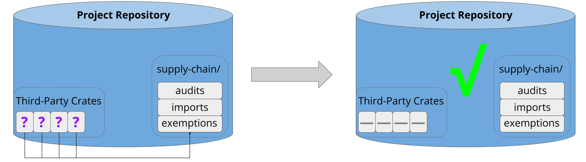
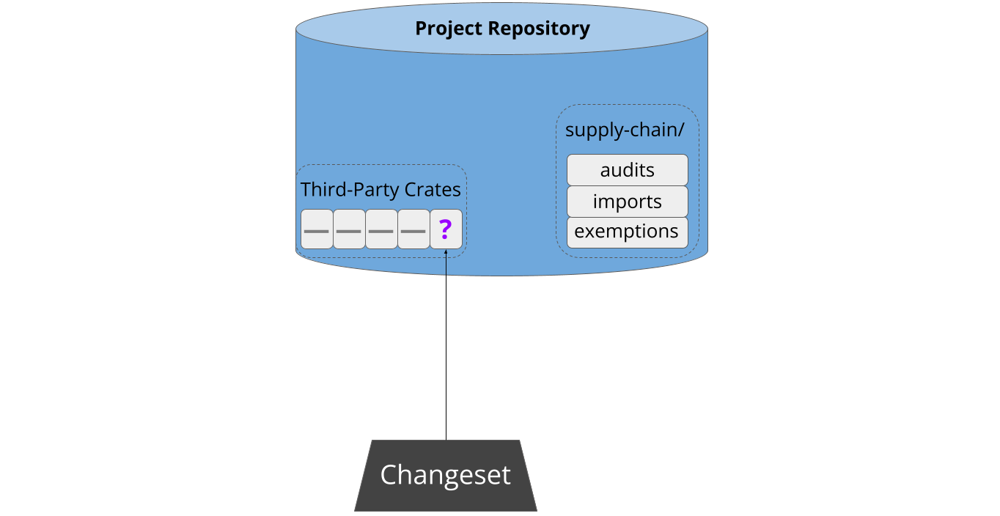
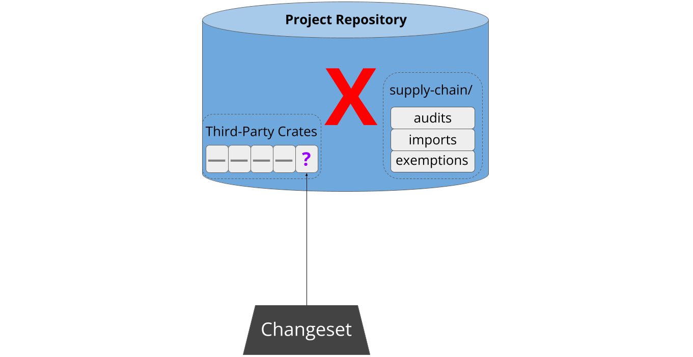
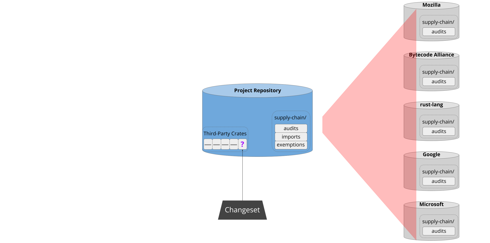
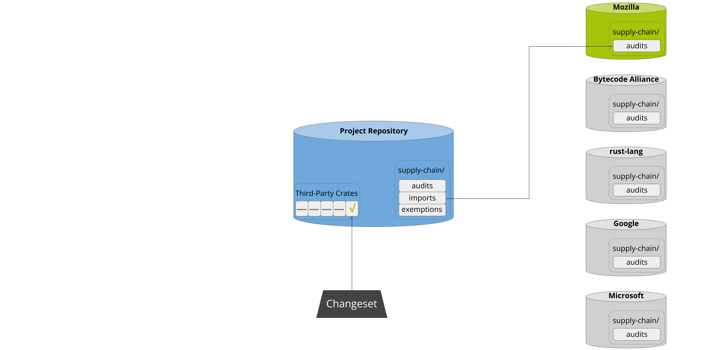
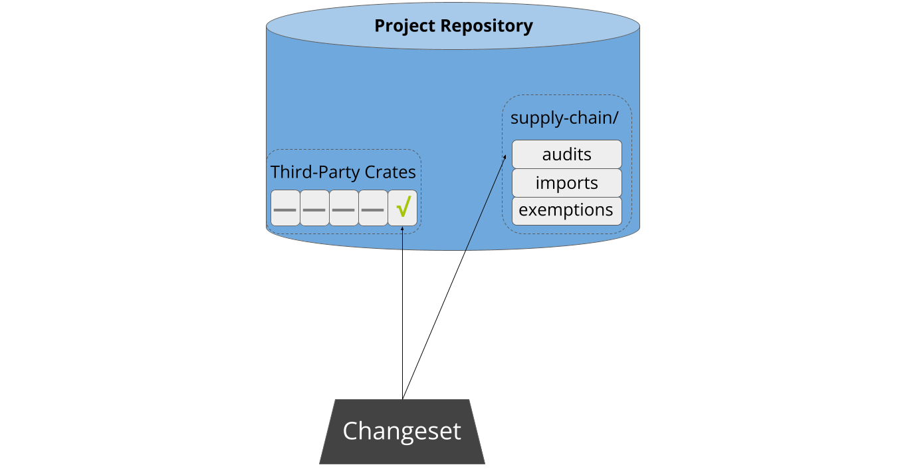
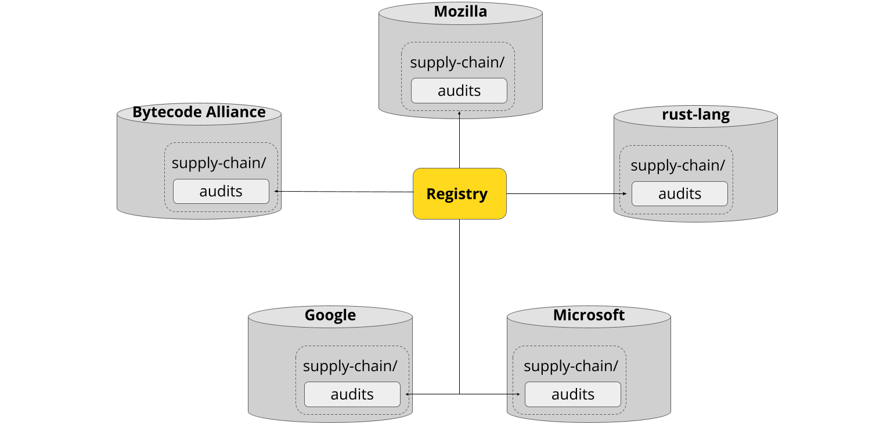


# 仕組み {#how-it-works}

ほとんどの開発者は忙しく、サプライチェーンの完全性に割ける労力は限られています。そこで cargo-vet は、手間を最小限に抑え、正しいことをできるだけ簡単に行えるようにすることを基本方針としています。セットアップがごく簡単で、既存の作業の流れに邪魔にならない形でなじみ、各手順で利用者を案内し、広く使われているパッケージを監査する作業をエコシステム全体で分かち合えるようにすることを目指しています。

この節では、これらの目標を達成するために、この仕組みがどのように動くのかを大まかに説明します。

## セットアップ {#setup}

<!-- diagrams: https://docs.google.com/presentation/d/18svkEsm9K5gLQeJLfILGdMUTsujiDgzecrswcOAdceQ/edit -->

cargo-vet のセットアップは簡単です。ほとんどの利用者は、すでにサードパーティの依存をいくつか含むリポジトリを持っているでしょう。

cargo-vet を有効にするには、このツールをリンターとして追加し、`cargo vet init` を実行します。すると、リポジトリにいくつかのメタデータが作られます。

この作業は 5 分ほどで終わります。そして重要なのは、既存の依存を監査する必要がないことです。既存の依存は、自動的に免除の一覧に追加されます。

これにより、少ない手間で使い始めることができ、承認済みの状態を出発点として、積み残しを少しずつ片付けていきやすくなります。

## 新しいサードパーティのコードを追加する {#adding-new-third-party-code}

しばらくして、ある開発者が新しいサードパーティのコードをプロジェクトに取り込もうとします。新しい依存の場合もあれば、既存の依存の更新の場合もあります。

cargo-vet は継続的インテグレーションの一部として、更新されたビルドグラフを分析し、新しいコードが信頼できる組織によって監査されていることを確かめます。監査されていなければ、そのパッチは拒否されます。

次に、cargo-vet は開発者がこの状況を解決するのを手助けします。まず、レジストリを調べて、よく知られた組織がそのパッケージを以前に監査していないかを確かめます。

該当するものがあれば、cargo-vet は開発者にそれを知らせ、その組織をプロジェクトの信頼するインポートに追加するという選択肢を示します。

これにより、プロジェクトは、承認済みのクレートの集合を、必要になったつど少しずつ広げていけます。インポートと監査のどちらの提出についても、承認は自動的に `supply-chain/` ディレクトリのコードオーナーが担うことになります。コードオーナーは、プロジェクトの責任者か、専任のセキュリティチームにしておくべきです。

## 監査の流れ {#auditing-workflow}

もちろん、開発者が自分で監査を行う必要がある場合もあり、cargo-vet はその作業を効率よく進められるようにします。同じクレートの別のバージョンを、誰かがすでに監査していることはよくあります。その場合、cargo-vet は関係する差分を計算し、最も小さいものを特定します[^1]。何を監査すべきかを決めるところまで開発者を案内したあと、調べる対象となる成果物を、ローカル、[Sourcegraph](https://sourcegraph.com)、[diff.rs](https://diff.rs) のいずれかで提示します。

cargo-vet は、監査をリポジトリのツリー内に保存することで、開発者の手間を最小限に抑えます。つまり、開発者は外部のシステムを操作したり、そこで認証したりする必要がありません。cargo-vet とのやり取りは、たいてい、開発者が新しいサードパーティのコードを追加する変更セットを作ったときに発生します。この設計のおかげで、開発者は関係する監査をその変更セットの一部としてそのまま提出できます。

## 作業を分かち合う {#sharing-the-work}

cargo-vet の共有と発見の仕組みは、この分散型の保存方法の上に成り立っています。インポートは、外部のリポジトリにある監査ファイルを直接指すことで実現されており、レジストリは、よく知られた組織が持つそうしたファイルの索引にすぎません。

これは、攻撃者が侵害できるような中央の基盤が存在しないということでもあります。依存グラフの検証に使われるインポートは、必ず当の組織から直接取得され、しかもその組織を信頼する集合に明示的に追加したあとでなければ取得されません。

監査の共有は、`cargo vet` の効果を何倍にも高める重要な要素ですが、必須ではありません。もちろん、プロジェクトはインポートを一切追加せず、すべての監査を自分たちで行うこともできます。

## そのほかの機能 {#additional-features}

cargo-vet は、内部に高度な機能をいくつも備えています。カスタムの監査基準、ビルドグラフ内の部分木ごとに設定できるポリシー、プラットフォーム固有のコードの除外に対応しています。これらの機能はどれも完全に任意であり、基本的な使い方は、単純で、導入時に覚えることが最小限で済むように設計されています。詳しくは、本書のこのあとの章で学べます。

## 脚注 {#footnotes}

[^1]: 差分監査は、免除の一覧にあるクレートに対しても機能します。素性の分からないバージョンを基準にして相対的なセキュリティ監査を行うのは、直感に反するように思えるかもしれません。それでも、そうすることで、将来のサプライチェーン攻撃に対して意味のある防御が得られます。

